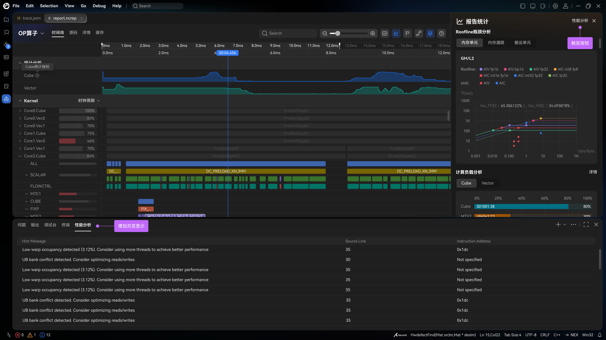

# Performance hints

| | |
|--|--|
| **Id** | `performance-hints` |
| **Panel / component** | `PerformanceHintsDock` bottom dock (性能提示 / 性能分析) — built |
| **Capability** | `performanceHints` |
| **Phase** | M4 |
| **Unification** | `adapt-mapper` |
| **Sept 30 (emulate)** | **in** |
| **Compute** | **in** — [`Summary.jsonl`](../formats/compute/summary.jsonl.md) `PerformanceHints` (PR-VM-027 / #177) |

## Sketches



Preview (1600×900) of the full frame [`v930-sim/performance-hints`](../ui/source/930/ReportPanelPerformanceTips/screenshot.png) (7680×4320). Sketch shows a **性能分析** table under the timeline: **Hint Message**, **Source Line**, **Instruction Address**. Annotations call for a **性能分析** tab (增加页签 / 增加页面显示) and a **title-row 性能分析** trigger left of the aside close × (触发按钮). Empty Source Line / Instruction Address cells show **Not specified** (sketch fidelity).

## Purpose

List performance hints for the open report: advice text, the source line it attaches to (emulate), and the instruction address when the hint is per-PC (emulate). Compute packs feed message-only rows from [`Summary.jsonl`](../formats/compute/summary.jsonl.md) `PerformanceHints` (PR-VM-027); emulate joins the five Hint* CSVs.

**Trigger.** The aside **title-row** **性能分析** link (left of close ×; [`aside-hints-title-row.png`](../../src/ui/StatsAside/visual/aside-hints-title-row.png)) is environment-routed ([environments.ts](../../src/ui/environments.ts)): under `environment: 'vscode'` it emits `open-performance-hints-in-problems` and the host reveals its native Problems diagnostics (no dock opens), while the `'browser'` default opens the pane in the standard event-detail dock ([ProfilingReport spec](../../src/ui/ProfilingReport/ProfilingReport.spec.md) `PR-ROOT-021`).

## View-model

| Field | Role | Required? |
|-------|------|-----------|
| `hintRows[]` (planned) | Rows for the 性能分析 table | **Required to show** |
| `hintRows[].message` | Hint Message column | Required per row |
| `hintRows[].sourceLine` | Source Line column | Optional |
| `hintRows[].instructionAddress` | Instruction Address column | Optional |
| `hintRows[].kind` | `instruction` \| `sourceLine` \| `kernel` | Optional (for grouping) |

## Hide rule

No joined hint rows → **hide** the panel ([DATA-30](../context/decisions/DATA.md)). Do not invent hints from compute CSVs ([DATA-45](../context/decisions/interim/DATA.md#data-45)).

## Compute fill

Schema: [compute/SCHEMA](../formats/compute/SCHEMA.md) §11.10. **Mapper wired** — `adaptPayloads` reads the `PerformanceHints` category from [`Summary.jsonl`](../formats/compute/summary.jsonl.md) (PR-VM-027 / #177). Does not invent hints from CSVs ([DATA-45](../context/decisions/interim/DATA.md#data-45)); does not re-run H01–H12.

| VM field | Source embed(s) | Join key(s) | Derivation |
|----------|-----------------|-------------|------------|
| `performanceHints[].message` | [`Summary.jsonl`](../formats/compute/summary.jsonl.md) `category: PerformanceHints` | — | Each non-empty trimmed string in `hints[]` |
| `performanceHints[].origin` | — | — | Always `'kernel'` (no pc / sourceLineId → dock “Not specified”) |

## Emulate fill

Schemas: [SCHEMA](../formats/emulate/SCHEMA.md) ([`HintMessages.csv`](../formats/emulate/HintMessages.csv.md), [`HintTypes.csv`](../formats/emulate/HintTypes.csv.md), [`InstructionHints.csv`](../formats/emulate/InstructionHints.csv.md), [`KernelHints.csv`](../formats/emulate/KernelHints.csv.md), [`SourceLineHints.csv`](../formats/emulate/SourceLineHints.csv.md), [`SourceLines.csv`](../formats/emulate/SourceLines.csv.md)). Pack status: [TABLES](../formats/emulate/TABLES.md). **Mapper wired** — joins below are the contract implemented by `adaptEmulate`.

### Embeds involved

| Embed | Role |
|-------|------|
| [`HintMessages.csv`](../formats/emulate/HintMessages.csv.md) | Message dictionary (`HintMsgId` → `HintMsgText`) |
| [`HintTypes.csv`](../formats/emulate/HintTypes.csv.md) | Type dictionary (`HintTypeId` → `HintTypeName`, `HintPassed`) |
| [`InstructionHints.csv`](../formats/emulate/InstructionHints.csv.md) | Fact: hint per PC |
| [`SourceLineHints.csv`](../formats/emulate/SourceLineHints.csv.md) | Fact: hint per source-line id |
| [`KernelHints.csv`](../formats/emulate/KernelHints.csv.md) | Fact: kernel-level hint (no PC, no line) |
| [`SourceLines.csv`](../formats/emulate/SourceLines.csv.md) | Line display text (`SourceLineId` → `SourceLine`) — often empty without `--object-file` |

Optional pre-joined producer views ([`InstructionHintsView.csv`](../formats/emulate/InstructionHintsView.csv.md), [`SourceLineHintsView.csv`](../formats/emulate/SourceLineHintsView.csv.md), [`KernelHintsView.csv`](../formats/emulate/KernelHintsView.csv.md)) may already carry `HintMsgText`; prefer raw tables + joins unless a packed view is present and complete.

### Join graph

```text
InstructionHints ──HintMsgId──► HintMessages.HintMsgText
       │
       ├──HintTypeId──► HintTypes.HintTypeName
       └──PC (display as instruction address; no further join)

SourceLineHints ──HintMsgId──► HintMessages.HintMsgText
       │
       ├──HintTypeId──► HintTypes.HintTypeName
       └──SourceLineId──► SourceLines.SourceLine   ← gap when SourceLines empty

KernelHints ──HintMsgId──► HintMessages.HintMsgText
       └──HintTypeId──► HintTypes.HintTypeName
```

### Join keys (normative)

| From embed | Key column | To embed | To column | Result column |
|------------|------------|----------|-----------|---------------|
| [`InstructionHints.csv`](../formats/emulate/InstructionHints.csv.md) / [`SourceLineHints.csv`](../formats/emulate/SourceLineHints.csv.md) / [`KernelHints.csv`](../formats/emulate/KernelHints.csv.md) | `HintMsgId` | [`HintMessages.csv`](../formats/emulate/HintMessages.csv.md) | `HintMsgId` | `HintMsgText` |
| same fact tables | `HintTypeId` | [`HintTypes.csv`](../formats/emulate/HintTypes.csv.md) | `HintTypeId` | `HintTypeName` (optional UI) |
| [`SourceLineHints.csv`](../formats/emulate/SourceLineHints.csv.md) | `SourceLineId` | [`SourceLines.csv`](../formats/emulate/SourceLines.csv.md) | `SourceLineId` | `SourceLine` |
| [`InstructionHints.csv`](../formats/emulate/InstructionHints.csv.md) | `PC` | _(none)_ | — | display as instruction address |

Equality join on integer ids. Drop a fact row if `HintMsgId` does not resolve (no message text). Missing `HintTypeId` is OK (message still shows). Missing [`SourceLines.csv`](../formats/emulate/SourceLines.csv.md) row → leave `sourceLine` empty (do not invent).

### VM field ← source (derivation)

| VM field | Source embed(s) | Join key(s) | Derivation |
|----------|-----------------|-------------|------------|
| `hintRows[].message` | fact + [`HintMessages.csv`](../formats/emulate/HintMessages.csv.md) | `HintMsgId` | `HintMsgText`; optionally prefix/suffix with `HintTypeName` when `HintTypeId` resolves |
| `hintRows[].instructionAddress` | [`InstructionHints.csv`](../formats/emulate/InstructionHints.csv.md) | — | `PC` (rendered `0x`-hex in the dock) |
| `hintRows[].sourceLine` | [`SourceLineHints.csv`](../formats/emulate/SourceLineHints.csv.md) + [`SourceLines.csv`](../formats/emulate/SourceLines.csv.md) | `SourceLineId` | `SourceLines.SourceLine`; **gap** when [`SourceLines.csv`](../formats/emulate/SourceLines.csv.md) is empty / unpacked |
| `hintRows[].kind` | which fact table produced the row | — | `instruction` from [`InstructionHints.csv`](../formats/emulate/InstructionHints.csv.md); `sourceLine` from [`SourceLineHints.csv`](../formats/emulate/SourceLineHints.csv.md); `kernel` from [`KernelHints.csv`](../formats/emulate/KernelHints.csv.md) |
| kernel-only row | [`KernelHints.csv`](../formats/emulate/KernelHints.csv.md) + [`HintMessages.csv`](../formats/emulate/HintMessages.csv.md) | `HintMsgId` | Message only; `sourceLine` and `instructionAddress` omitted |

Union all three fact kinds into one `hintRows[]` (stable order: instruction → sourceLine → kernel, or product-defined). Deduping by `(kind, HintId)` if the same hint appears twice.

[`HintMessages.csv`](../formats/emulate/HintMessages.csv.md), [`InstructionHints.csv`](../formats/emulate/InstructionHints.csv.md), [`KernelHints.csv`](../formats/emulate/KernelHints.csv.md), and [`SourceLineHints.csv`](../formats/emulate/SourceLineHints.csv.md) may be packed even when the export catalog records `row_count` 0.

## Adapter

| Profile | Entry | Notes |
|---------|-------|-------|
| compute | `adaptPayloads` / `adaptRep` | Wired — [`Summary.jsonl`](../formats/compute/summary.jsonl.md) `PerformanceHints` → `reportModel.performanceHints` + capability `performanceHints` (PR-VM-027); omit when empty ([DATA-30](../context/decisions/DATA.md)) |
| emulate | `adaptEmulate` | Wired — joins the five hint CSVs into `reportModel.performanceHints` + capability `performanceHints` |

## Related

- Plan: [milestone-4](../process/roadmap/milestone-4.md)
- Schema: [SCHEMA](../formats/emulate/SCHEMA.md) hint tables
- Sketch index: [DESIGN_INDEX](../ui/DESIGN_INDEX.md)
- Catalog: [README](README.md)
