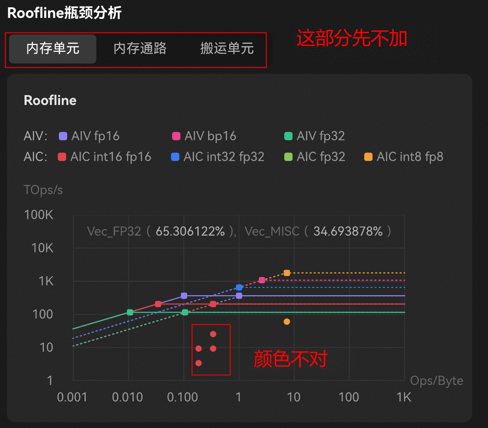

# Roofline

| | |
|--|--|
| **Id** | `roofline` |
| **Panel / component** | `RooflinePanel` → `src/ui/StatsAside/RooflinePanel/` |
| **Capability** | `roofline` |
| **Phase** | M2 |
| **Unification** | `gap` (emulate — same panel, different mapper) |
| **Sept 30 (emulate)** | **hide** |

## Sketches

**Component crop:** 

## Purpose

Log-log intensity vs achieved performance chart with **multi-series** AIV/AIC theoretical roofs, colored measured points, and optional op-mix labels. Tabs 内存单元 / 通路 / 搬运 are **omitted**.

## View-model

| Field | Role | Required? |
|-------|------|-----------|
| `reportModel.roofline.points[]` | Measured points (`color` matches series) | **Required to show** |
| `roofline.series[]` | AIV/AIC dtype roofs (`p_peak`, `b_peak`) | Required when shown |
| `roofline.mixLabels` | Op-mix annotation | Optional |
| capability `roofline` | Feature gate | **Derived** when points exist; host `capabilities` overrides wholesale |

## Hide rule

No usable points → hide panel ([DATA-30](../context/decisions/DATA.md)). Adapter advertises `roofline` when points exist.

## Axes and roof (npu-compute §11.8)

| Element | Formula / source |
| --- | --- |
| X intensity `I` | `I = w / q` (Ops/Byte) |
| Y performance `P` | `P = w / t` (ops/s → TOps/s via `/ 1e12` when raw) |
| Bandwidth ceiling | `b_peak` GB/s (default **1600** = 1.6 T/s); slope `b_peak × I / 1000` TOps/s |
| Theoretical roof | `min(p_peak, b_peak × I / 1000)` per dtype series |
| L2 series | **Omit** |

**`p_peak` formulas** (frequency in MHz → TOps/s). Divide by `1e6`. A `/ 1000` reading is ~1000× this axis and does not match example ceilings or `p_peak / 1e12`.

| Executor | Dtype | Formula |
| --- | --- | --- |
| cube | fp16/bf16 | `cube_num × 4096 × 2 × frequency / 1e6` |
| cube | tf32/hf32 | `cube_num × 2048 × 2 × frequency / 1e6` |
| cube | int8/fp8 | `cube_num × 8192 × 2 × frequency / 1e6` |
| vector | fp16/bf16 | `vector_num × 128 × 2 × frequency / 1e6` |
| vector | fp32 / int32 | `vector_num × 64 × 2 × frequency / 1e6` |

## Compute fill

| Adapted field | Embed | Columns / notes | Schema SSOT |
|---------------|-------|-----------------|-------------|
| points + series | Prefer `HardwareInfo.jsonl` category `Roofline`. Overlay only a positive `p_peak` and a positive `b_peak` (non-positive `b_peak` keeps 1600 GB/s); missing / ≤0 `p_peak` keeps the formula or example roof. Measured points from `w`/`t`/`q` still emit. Hover label is the legend name, plus the producer key when several points share a series | Else GM from ArithmeticUtilization + Memory | [METRICS](../formats/compute/METRICS_AND_TRACE.md), [view-models](../../specs/core/view-models.spec.md) |
| roofs when JSON absent | §11.8.1 from AI Core counts + that side's frequency (a shared core clock fills a side with no own clock), else product example ceilings | — | |
| mix labels | `ArithmeticUtilization` dtype ratios | Normalize non-zero to % | |
| block scope | **All** = `summary.jsonl` categories; block = CSV rows for GM + mix only. Chip-level `series` roofs and non-`gm` HardwareInfo measured points stay from the All model | [DATA-19](../context/decisions/DATA.md) / [DATA-29](../context/decisions/DATA.md) | |

Code: `rooflineFromRows` / `buildRooflineViewModel` in `src/adapters/roofline.ts`.

### Legend (UI)

At the top of the raised card (**no** duplicate in-card **Roofline** title — the aside `h4` is enough), left-aligned with **TOps/s**. One CSS grid for both rows so the nth AIV / AIC swatches share a vertical edge (e.g. AIV bp16 with AIC int32 fp32). Group heads `#c4c4c4`, series labels `#8a8a8a`. Op-mix (`Vec_FP32 (…%)`, …) shares the **TOps/s** alphabetic baseline above the plot — not inside the plot well. Roofs use the same series colors (`2px`; **AIV** roofs dashed, **AIC** roofs solid — both slope + plateau). Marker shapes follow the product stats sketch: **circles** for measured points off the roofs; **filled rounded-square** knees on each ridge (`8×8`, `rx=2`, series color, same as legend). Legend hover (experimental) thickens that roof and dims the others.

| Group | Series (colors) |
| --- | --- |
| AIV | fp16 `#8C78F0`, bp16 `#E63C82`, fp32 `#32BE8C` |
| AIC | int16 fp16 `#E53935`, int32 fp32 `#4C8DFF`, fp32 `#B4E04A`, int8 fp8 `#F0A020` |

## Emulate fill

| Adapted field | Embed | Columns / notes | Status |
|---------------|-------|-----------------|--------|
| `roofline` | ArchDiagramMetrics + ExecutedInstructions + VectorUtilizations ± ELF | New mapper required | `gap` → hide Sept 30 |

## Related

- Spec: [RooflinePanel.spec.md](../../src/ui/StatsAside/RooflinePanel/RooflinePanel.spec.md)
- Product: npu-compute §11.8 / docx §11.2.4
