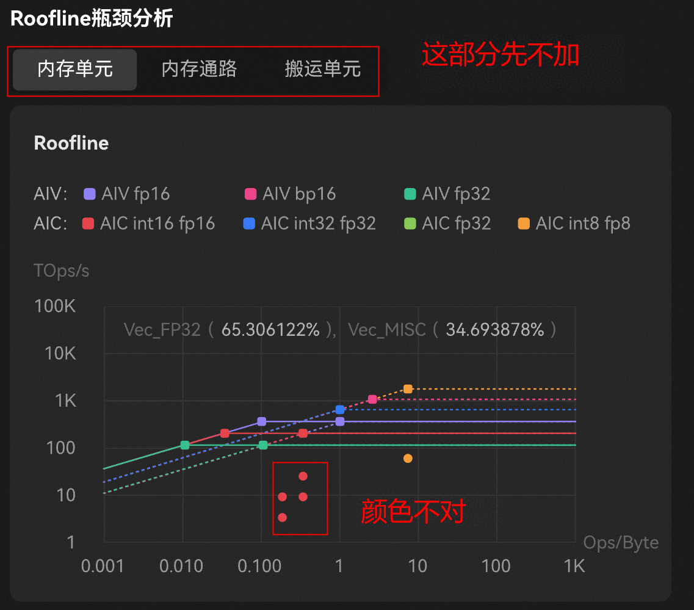

# Roofline

| | |
|--|--|
| **Id** | `roofline` |
| **Panel / component** | `RooflinePanel` → `src/ui/StatsAside/RooflinePanel/` |
| **Capability** | `roofline` |
| **Phase** | M2 |
| **Unification** | `adapt-mapper` (emulate — same panel, Roofline* CSV mapper) |
| **Sept 30 (emulate)** | **in** when Roofline points exist; gate on AnalysisState only when that CSV is packed (failed `roofline` row → omit; absent AnalysisState still adapts; `roofline.json` fallback) ([DATA-57a](../context/decisions/interim/DATA.md#data-57a)) |

## Sketches

**1130 export (Roofline / Throughput tab states; tabs remain omitted in code, DATA-37f):** 

**Component crop:** 

## Purpose

Log-log intensity vs achieved performance chart with **multi-series** AIV/AIC theoretical roofs, colored measured points, and optional op-mix labels. Tabs 内存单元 / 通路 / 搬运 are **omitted**.

## View-model

| Field | Role | Required? |
|-------|------|-----------|
| `reportModel.roofline.points[]` | Measured points (`color` matches series) | **Required to show** |
| `roofline.series[]` | AIV/AIC dtype roofs (`p_peak`, `b_peak`) | Required when shown |
| `roofline.mixLabels` | Op-mix annotation | Optional |
| capability `roofline` | Feature gate | **Derived** when points exist; host `capabilities` overrides wholesale |

## Hide rule

No usable points → hide panel ([DATA-30](../context/decisions/DATA.md)). Adapter advertises `roofline` when points exist.

## Axes and roof (npu-compute §11.8)

| Element | Formula / source |
| --- | --- |
| X intensity `I` | `I = w / q` (Ops/Byte) |
| Y performance `P` | `P = w / t` (ops/s → TOps/s via `/ 1e12` when raw) |
| Bandwidth ceiling | `b_peak` GB/s (default **1600** = 1.6 T/s); slope `b_peak × I / 1000` TOps/s |
| Theoretical roof | `min(p_peak, b_peak × I / 1000)` per dtype series |
| L2 series | **Omit** |

**`p_peak` formulas** (frequency in MHz → TOps/s). Divide by `1e6`. A `/ 1000` reading is ~1000× this axis and does not match example ceilings or `p_peak / 1e12`.

| Executor | Dtype | Formula |
| --- | --- | --- |
| cube | fp16/bf16 | `cube_num × 4096 × 2 × frequency / 1e6` |
| cube | tf32/hf32 | `cube_num × 2048 × 2 × frequency / 1e6` |
| cube | int8/fp8 | `cube_num × 8192 × 2 × frequency / 1e6` |
| vector | fp16/bf16 | `vector_num × 128 × 2 × frequency / 1e6` |
| vector | fp32 / int32 | `vector_num × 64 × 2 × frequency / 1e6` |

## Compute fill

| Adapted field | Embed | Columns / notes | Schema SSOT |
|---------------|-------|-----------------|-------------|
| points + series | Prefer [`HardwareInfo.jsonl`](../formats/compute/HardwareInfo.jsonl.md) category `Roofline`, else the same object in [`summary.jsonl`](../formats/compute/summary.jsonl.md). Overlay only a positive `p_peak` and a positive `b_peak` (non-positive `b_peak` keeps 1600 GB/s); missing / ≤0 `p_peak` keeps the formula or example roof. Measured points from `w`/`t`/`q` still emit. Hover label is the legend name, plus the producer key when several points share a series. Units follow npu-compute `roofline性能采集.md`: `t` is whole-kernel seconds, `p_peak` is full ops, `I = w / q`, `P = w / t` (ops/s → TOps/s via `/ 1e12`) | Else GM from [`ArithmeticUtilization.csv`](../formats/compute/ArithmeticUtilization.csv.md) + [`Memory.csv`](../formats/compute/Memory.csv.md) | [METRICS](../formats/compute/METRICS_AND_TRACE.md), [view-models](../../specs/core/view-models.spec.md) |
| roofs when JSON absent | §11.8.1 from AI Core counts + that side's frequency in `HardwareInfo.jsonl` only (a shared core clock fills a side with no own clock), else product example ceilings. A `summary.jsonl` line does not replace those counts | — | |
| mix labels | [`ArithmeticUtilization.csv`](../formats/compute/ArithmeticUtilization.csv.md) dtype ratios | Normalize non-zero to % | |
| block scope | **All** = [`summary.jsonl`](../formats/compute/summary.jsonl.md) categories; block = CSV rows for GM + mix only. Chip-level `series` roofs and non-`gm` measured points stay from the All model when the block has ArithmeticUtilization or Memory rows that cannot build a GM point. A block with neither of those rows hides the chart | [DATA-19](../context/decisions/DATA.md) / [DATA-29](../context/decisions/DATA.md) | |

Code: `rooflineFromRows` / `buildRooflineViewModel` in `src/adapters/roofline.ts`.

### Legend (UI)

At the top of the raised card (**no** duplicate in-card **Roofline** title — the aside `h4` is enough), left-aligned with **TOps/s**. One CSS grid for both rows so the nth AIV / AIC swatches share a vertical edge (e.g. AIV bf16 with AIC int32 fp32). Group heads `#c4c4c4`, series labels `#8a8a8a`. Op-mix (`Vec_FP32 (…%)`, …) shares the **TOps/s** alphabetic baseline above the plot — not inside the plot well. Roofs use the same series colors (`2px`; **AIV** roofs dashed, **AIC** roofs solid — both slope + plateau). Marker shapes follow the product stats sketch: **circles** for measured points off the roofs (`r=4`; `r=5` while that point's tip is open); **filled rounded-square** knees on each ridge (`8×8`, `rx=2`, series color, same as legend; `10×10` while that knee's tip is open). Legend hover (experimental) thickens that roof and dims the others.

| Group | Series (colors) |
| --- | --- |
| AIV | fp16 `#8C78F0`, bp16 `#E63C82`, fp32 `#32BE8C` |
| AIC | int16 fp16 `#E53935`, int32 fp32 `#4C8DFF`, fp32 `#B4E04A`, int8 fp8 `#F0A020` |

## Emulate fill

Producer (`BIPROF_OPTS='--roofline'`) persists analyzer tables and packs them into `.npu-rep`. The viewer **does not** re-derive I/P from ExecutedInstructions / VectorUtilizations ([DATA-45](../context/decisions/interim/DATA.md#data-45)). Contract: npu-simulator `roofline_data_format.md` (architecture `v100`).

| Adapted field | Embed | Columns / notes | Status |
|---------------|-------|-----------------|--------|
| gate | [`AnalysisState.csv`](../formats/emulate/AnalysisState.csv.md) | Latest `AnalysisName = roofline` with `AnalysisPassed = 1` | Required when AnalysisState packed |
| points | [`RooflinePoints.csv`](../formats/emulate/RooflinePoints.csv.md) | `ArithmeticIntensity` → `intensity`; `PerformanceGFlops / 1000` → `performance` (TOps/s); label `{shortFn} - {SIMD\|SIMT\|SIMT-OUT\|L0\|CUBE-OUT}`; color by mode heuristic (SIMD→`aiv-fp16`, SIMT→`aiv-bp16`, CUBE→`aic-int16-fp16`) | **Required to show** |
| series | [`RooflineComputePeaks.csv`](../formats/emulate/RooflineComputePeaks.csv.md) × [`RooflineBandwidthPeaks.csv`](../formats/emulate/RooflineBandwidthPeaks.csv.md) | Per-`Unit` cross-product (HTML all-on roofs). `PeakGFlops / 1000` → `peakComputeTops`; `PeakGBs` → `peakBandwidthGBs`. `SIMD-UB` solid; other memory levels dashed. AIC `tf32_hf32` → `aic-tf32-hf32`; AIC `fp32` → `aic-fp32` (not `aic-int32-fp32`) | Required when shown |
| fallback | [`roofline.json`](../formats/emulate/roofline.json.md) | Debug export only when the Roofline CSVs are absent | Optional |
| mix labels | — | Empty (no ArithmeticUtilization dtype ratios) | Optional omitted |

Code: `rooflineFromEmulatePayloads` in `src/adapters/rooflineEmulate.ts` ([DATA-57a](../context/decisions/interim/DATA.md#data-57a)).

Memory-level map (CSV → debug / HTML bw key): `SIMD-UB`→SIMD/`peakBandwidthSIMD`; `SIMT-UB`→SIMT; `SIMT-OUT`→SIMT-OUT; `CUBE-L0`→L0; `CUBE-OUT`→CUBE-OUT.

## Related

- Spec: [RooflinePanel.spec.md](../../src/ui/StatsAside/RooflinePanel/RooflinePanel.spec.md)
- Product: npu-compute §11.8 / docx §11.2.4; emulate [DATA-57a](../context/decisions/interim/DATA.md#data-57a)
