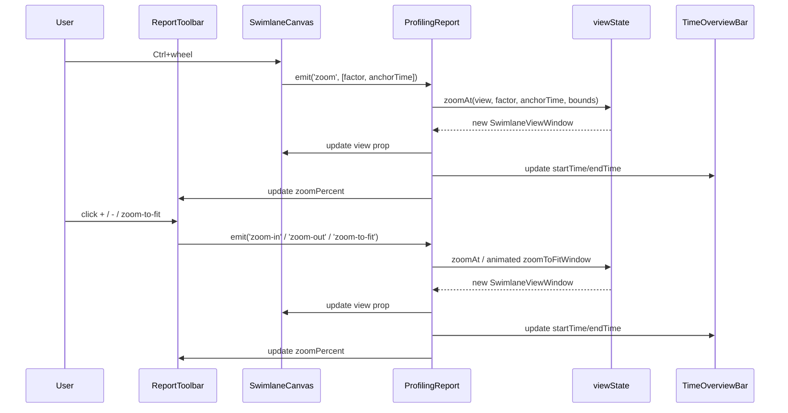
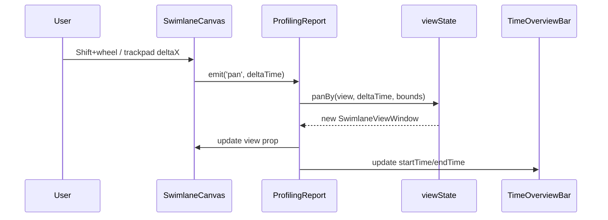
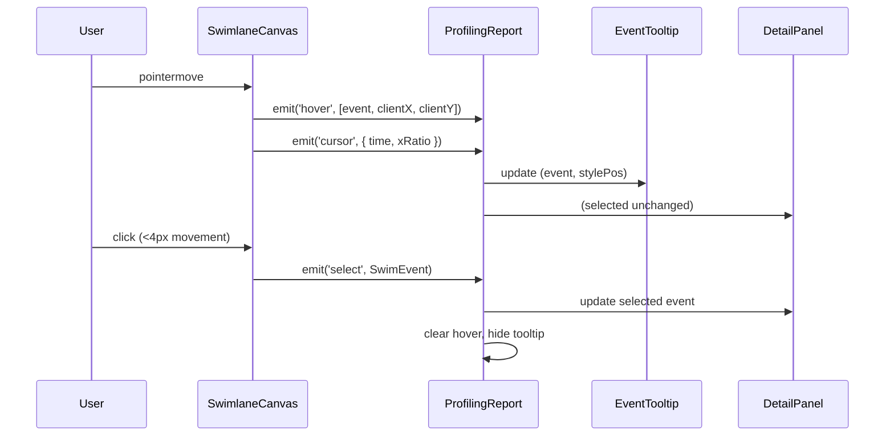
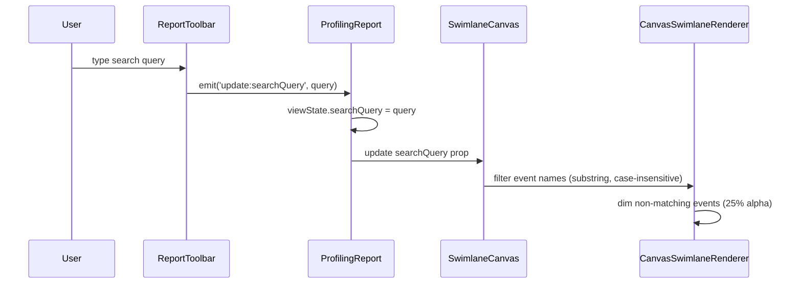
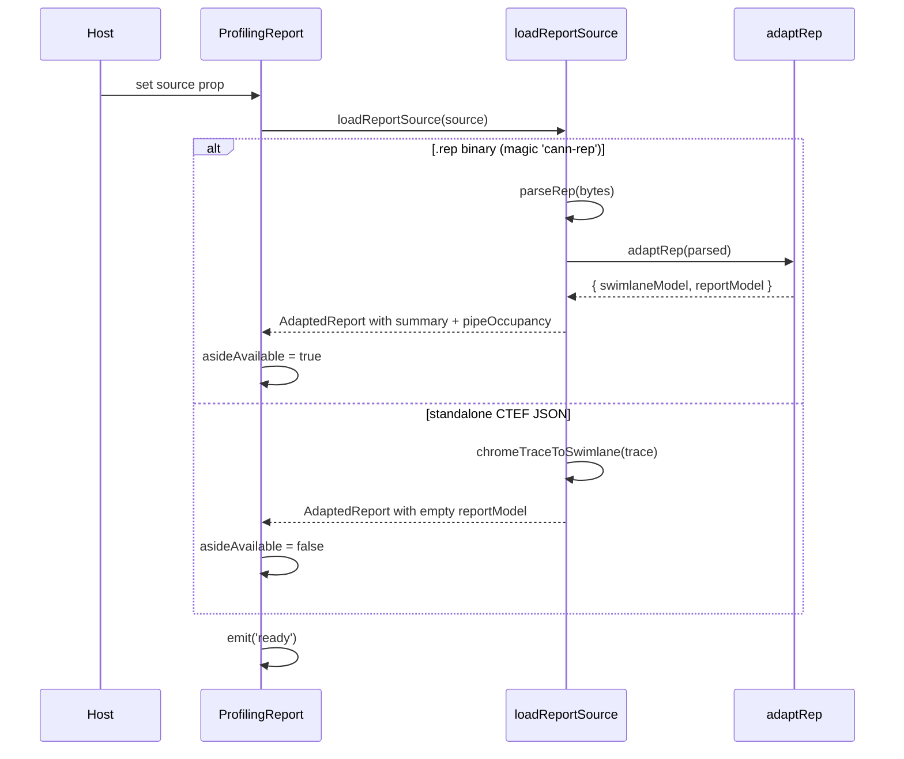

# ProfilingReport

| spec-id-prefix |
|----------------|
| PR-ROOT-*      |

Root component and single owner of all interaction state. Orchestrates data loading, viewport management, and event coordination across child components.

## Inputs

The component works in two modes. In **auto-loading mode**, provide **source** — a binary buffer containing a `.npu-rep` (or classic engineering `.rep` fixture) or standalone CTEF JSON. The component detects, parses, and renders automatically. In **host-managed mode**, provide pre-parsed **swimlaneModel** and **reportModel** to skip the internal pipeline. The tab strip shows the operator selector only for multi-operator packs; with zero or one operator it starts with the tabs and no brand. **概览** appears only when `operatorRows` exist and is never the landing tab. **theme** and **locale** control presentation. Wall-time labels auto-scale (`TimeScaleUnit`: s / ms / µs / ns) from viewport span and overview axis density — there is no `timeUnit` host prop (removed; see changelog); optional **timeDisplayMode** (`'time' | 'cycles'`) switches the whole report to derived CPU clocks when OpBasicInfo freq is present ([UI-40](../../../docs/context/decisions/UI.md) / [UI-45](../../../docs/context/decisions/UI.md)). **dependencyMode** (`all` / `predecessors` / `successors`) and **dependencyDepth** (hops; default `1`, `-1` no hop cap, 10 000 links per side) filter selection curves, undimmed neighbors, and the detail dock's Relevent column alike; the dock's Relevent toolbar updates them in place (no page reload). **capabilities** gates Phase 2 features — an array of feature flag strings such as `'roofline'`, `'memoryDiagram'`, or `'dependencies'`. It is optional in auto-loading mode: the adapter derives capabilities from the source it just parsed and those apply on their own, so a host that passes only `source` still gets the panels its report can fill. The adapter also derives `'roofline'` when points exist. A supplied array overrides the derived ones wholesale (host-managed mode has no adapter to ask). Adapter-derived flags never outlive their report: they are dropped when `source` is cleared, and they are ignored entirely once the host drives `swimlaneModel` / `reportModel`, which publish an empty capability set unless the host passes its own array. Optional **reportMeta** (`CannbotReportMeta`: name/path/id/collectedAt) carries the report identity used for the cannbot payload's meta fields. Optional **cannbotSessions** (`CannbotSessions`, [cannbot contract](../../../specs/core/cannbot-payload.spec.md)) is forwarded to StatsAside verbatim — the latest session per scope, the single source of the per-scope button state; omit it in browser hosts and every scope renders idle. Optional **userGuideUrl** (default `DEFAULT_USER_GUIDE_URL`) is forwarded to the toolbar help button. Optional **allowHtmlExport** (default false) shows toolbar Export when `source` bytes exist; playground / hosts that serve the shell template pass true; the bundled report-shell leaves it false. Optional **htmlExportTemplateUrl** (default `/npu-rep-html-template.txt`) is fetched on export. Optional **environment** (`'vscode' | 'browser'`, open union so future hosts can be added without touching consumers; omitted or unknown behaves like `'browser'`) tells the root which host it runs in — environment-dependent actions are looked up in [`environments.ts`](../environments.ts) (`resolveEnvironmentBehavior`) instead of `if (environment === …)` branches. Today it routes the title-row **性能分析** trigger only (see Outputs / `PR-STATS-006c`).

Optional **baselines** (`Baseline[]`, entries may carry `operators: ReportOperator[]`), **baselineRows** (`BaselineRow[]`, `{ id, baselineId, operatorId }`) and **baselineReports** (`BaselineReports`, host-adapted packs keyed by baseline id) carry the host-owned checked set and comparison rows (对比基线). Row 0 is the primary and drives every aside value; the other rows surface only in the per-value hover popups, and multiple rows may reference the same baseline with different operators. Optional **recentBaselines** (`Baseline[]`) is the host's own report list the picker renders as checkboxes. Optional **pickBaselineFile** (`() => Promise<BaselinePick | null>`) is the host file dialog for Browse — absent, the baseline control is hidden (the library never reads the filesystem, same contract as `resolveSourceFile`). Optional **pickSourceWorkspace** (`PickSourceWorkspace`) is the host directory hook for source text a pack omitted: it receives the deduped `{ fileName, basename }` files that still hold a `// missing source embed:` placeholder and returns `{ files: { path, text }[] } | null`; the root fills only those placeholders and never replaces packed text ([UI-64](../../../docs/context/decisions/UI.md)). The root renders, forwards every toggle and row edit as `update:baselines` / `update:baselineRows`, and keeps one invariant — a row can only reference a checked baseline, and a checked set with no rows gets one default row; the host persists through the same emits. The library keeps no storage.

## Outputs

Lifecycle events: **ready** fires once the report is loaded and the timeline is rendered. **select** tracks the **single** selection: it fires with a `SelectedEvent` (id, name, startTime, duration, endTime) when the user clicks an event on the swimlane (or a marquee that covers exactly one event), and with `null` whenever the single selection is dismissed — an empty-space click, a cleared marquee (empty commit / Escape / dock close), or a **multi-event** marquee commit that replaces it with a multi-selection. In that last case `select(null)` arrives while the (internal) multi-select dock is active, so hosts read it as "no single selection", not "nothing is selected". The marquee's `multi-select` / `multi-select-span` are internal child→root emits, not part of the host surface ([public-api](../../../specs/architecture/public-api.spec.md)). **error** fires with `{ message, cause? }` on load or parse failure. **open-hardware-details** is forwarded from StatsAside when the user clicks 更多 (aside also opens interim HardwareDetailsPanel when data exists, DATA-34a). **open-pipe-details** is forwarded when the user clicks PIPE 详情 (aside navigates to CSV details). **view-full-csv** forwards `{ fileName, text }` for 查看全部 (DATA-33d). **cannbot-request** fires when a section cannbot icon is clicked, with the `CannbotPayload` assembled from the current reportModel + reportMeta (version/scope/report_name/report_id/report_path/op_name/collected_at/data/prompt). The emit is guarded by a 1s cooldown (防抖, misoperation guard, via the shared leading-edge [`cooldown`](../../../specs/core/cooldown.spec.md) util — one lock for **all** cannbot icons, since each emit opens a full host conversation): the first click fires immediately and any further cannbot click (same or different icon) inside the window is swallowed, so a misfired double-click cannot open multiple conversations. **open-cannbot-stop** forwards the running scope's 停止 click with the scope (host stops the session; R3). **cannbot-reference** / **cannbot-view** remain available as host events for 引用 / 查看 (R4). The stats aside hides both entries for 1130 pending CANNWork API integration in 1209. **perform-optimization** fires from the **Optimize** button in either Overview or the stats aside. Both buttons share the same 1s cooldown. Overview supplies the selected row’s OpName. The aside supplies the report summary’s OpName. **open-cannwork** forwards the toolbar's 打开CANNWork trigger click (R7). Each of these five carries its **own** 1s cooldown (same leading-edge util, same first-click-fires contract; R9 防抖) — independent locks, because the actions are separate intents: repeated optimization clicks leave the first 打开CANNWork click available. **open-user-guide** forwards the guide URL from the toolbar help button (toolbar also attempts `window.open`). **export-html** fires after a successful single-file HTML download (`{ fileName }`). **open-performance-hints-in-problems** fires from the aside's title-row **性能分析** trigger when the environment routes to Problems (`vscode`); the internal hints dock does not open in that case — the host reveals its own Problems diagnostics. Aside **close** is handled internally (`asideVisible = false`); it is not a root emit. **update:baselines** (the picker's checked set — every toggle and Browse) and **update:baselineRows** (the aside's comparison rows — add / remove / report / operator edits, pruned when a row's baseline leaves the checked set) are the only baseline mutations — the host persists both (ARCHITECTURE: host persistence via props/state; the library has no storage of its own). The component does not expose internal view state — viewport, hover, and cursor are managed internally.

## Interaction flows

### Zoom

Ctrl+wheel zooms around cursor position. Toolbar buttons zoom around viewport center. Zoom-to-fit eases both view edges to the full trace span (same animation as Δt measure focus). All zoom operations are clamped to timeline bounds. The toolbar `zoomPercent` slider shares the same range: 0 = fit, 100 = `MIN_WINDOW` (same floor as `zoomAt` / Ctrl+wheel), not a hard 100× cap.

### Wheel-pan

Time panning is **Shift+wheel** or a two-finger horizontal trackpad scroll — an unmodified drag marquees instead (see [MultiSelectSummary](../MultiSelectSummary/MultiSelectSummary.spec.md)). Pan is clamped to timeline bounds. A 4px threshold on pointer-up still separates click-to-select from a marquee drag.

### Hover, selection, tooltip

Hover is transient: tooltip follows the cursor. Selection is persistent: detail strip shows until user clicks empty space. Clicking empty space emits `select(null)` — tooltip, selection, and detail strip all clear. A 4px threshold on pointer-up gates selection: movement >4px between pointerdown and pointerup starts a marquee instead, so that press never selects.

### Search

The renderer applies event name filtering as a substring, case-insensitive match during draw. Events that match render at full opacity; non-matching events are dimmed to 25% opacity but remain visible and interactive (hover/select still work on dimmed events). Lanes with no matching events remain visible (empty lanes are not collapsed).

### Data loading

Two loading paths produce different results: `.rep` enables full UI (swimlane + aside with summary and pipe occupancy), standalone CTEF enables swimlane only (aside auto-hides per PROC-3).

## Behavior

**Data loading.** When `source` is provided (without pre-parsed models), the component calls `loadReportSource`, which detects `.rep` (magic bytes) vs standalone CTEF JSON. A `.rep` binary produces a full report with swimlane, summary, and pipe occupancy. Standalone CTEF produces swimlane only — the report model's `summary` is empty and `pipeOccupancy` is `[]`.

**Aside availability.** `asideAvailable` is true when duration, I/O bandwidth cards (DATA-8), PIPE, CSV tables, hardware details, or labelled topology exist — plus roofline points only when the `roofline` capability is present (adapter-derived when points exist). Name/type alone do not open the aside. Missing `bandwidthCards` on a host-managed model is treated as empty.

**State ownership.** ProfilingReport owns a single `SwimlaneViewState` object holding viewport bounds, selection (single and marquee), hover, search, playhead, and aside visibility. Children receive state as read-only props and emit events upward. All mutations create new object references to trigger Vue reactivity.

**Selection and the docks.** Single-select and marquee multi-select are mutually exclusive and drive mutually exclusive docks: `multiSelectedIds` non-empty mounts [MultiSelectSummary](../MultiSelectSummary/MultiSelectSummary.spec.md), else a `selectedEventId` mounts DetailPanel, else neither. The exclusivity itself lives in [view-state](../../../specs/core/view-state.spec.md) (`setSelectedEvent` / `setMultiSelection` / `clearSelection`), so the root just routes: canvas `multi-select` with **two or more** events sets the marquee dock; a **one-event** commit is demoted through the single-select path (DetailPanel) — same as a plain click; an **empty** commit clears both. The dock's `select-single` and `close` and an empty-space click and **Escape** go back through the single-select path. A multi-event marquee commit emits `select(null)` because the single selection was dismissed in favor of the multi-selection — so `select(null)` means "no single selection", and a host must not infer from it that nothing is selected (see Outputs).

**Live marquee dock preview.** While the canvas emits `multi-select-preview` (after the 4px gate), the root drives the dock UI from that payload without calling `setMultiSelection` / host `select` on every move: production canvas emits union **ids**; tests may still emit `SwimEvent[]`. **≥2** → MultiSelectSummary, **1** → DetailPanel, **empty** → clear Detail/Summary. While `marqueeLive`, a ≥2 summary keeps its table mounted, non-interactive, and **dimmed** — the header count updates from the id count immediately (`livePreview` / `liveCount`) without assigning a `SwimEvent[]`, and the stale table stays until the marquee has been still for `MULTI_SELECT_SETTLE_MS` (200ms) or the commit arrives, at which point the root resolves the ids and recalculates the table. The table is non-interactive for the whole live gesture (not just the stale window), so a name click cannot desync the dock from the in-flight marquee; a settle that was already queued when the commit lands is ignored (`marqueeLive` is false by then), so it cannot wipe the committed selection. **Gesture liveness** (`marqueeLive`) arms on any post-gate preview including `[]` so Escape is gated. Footer mount: when the dock was **already open** at drag start, empty coverage keeps the shell mounted with a nothing-selected message; when it was **closed**, the footer stays hidden until coverage is non-empty (no empty-state flash). On commit (`multi-select`) the existing empty / 1 / ≥2 rules apply once. Escape mid-drag: while `marqueeLive`, root does not `onSelect(null)`; the canvas cancels and emits `preview(null)`, which restores the pre-drag dock snapshot — no host `select`. Mode switches fade **content only** (`pr-dock-content` out-in, opacity ~180ms) inside the persistent `<footer class="pr-dock">`; the shell height stays `--pr-dock-h` (no height animation on single↔multi↔empty swap). Outer `pr-dock` Transition is only for true none↔some (open/close). **Enter** height-tweens from `0` so the timeline shrinks with the visible panel (no empty flex slot / black hole). **Leave** takes the dock `position: absolute` and slides it away so flex space frees immediately while the panel is still on screen. The root also owns the Δt span the axis draws for a multi-selection — the live marquee extent during the drag; the canvas clears it on commit so the axis Δt disappears when the rect commits. Both docks share the one session-only `dockHeight` inside that persistent footer.

**性能分析 hints pane.** The M4 [performance-hints dock](../PerformanceHintsDock/PerformanceHintsDock.spec.md) is the dock content chain's **last** branch, so `hintsDockOpen` (set by the StatsAside title-row 性能分析 trigger) plus the `performanceHints` capability only buys the slot while no single selection or marquee multi-selection is up. The trigger is **environment-routed**: `resolveEnvironmentBehavior` in [`environments.ts`](../environments.ts) maps the `environment` prop to a target — on `vscode` the trigger emits `open-performance-hints-in-problems` and returns (the host reveals its native Problems diagnostics and the dock is not touched), while `browser` / an omitted environment opens the internal pane. That browser path clears what would swallow the pane before it opens: a live marquee through `clearMarqueeLive()` (dock snapshot + marquee flags + preview throttle), then the committed selection through `onSelect(null)` — the same path the canvas uses, which clears `selected` / `multiSelected` / the Δt span / the `viewState` ids and emits the host `select(null)`. The pane then renders as a content branch of the **same** dock used for event details — standard `--pr-dock-h` height and `.pr-dock` chrome, no dedicated hints shell. One computed, `hintsDockShown`, mirrors that branch exactly and so gates the pane mount only. A later non-null timeline `onSelect` or marquee multi commit clears `hintsDockOpen` (`PR-ROOT-023`), so closing DetailPanel / MultiSelectSummary does not resurrect the hints pane without another 性能分析 click. The pane is handed the root's shared `dockHeight`, so its top-edge expander moves the same `--pr-dock-h` as the detail docks and the height carries over between branches and reopens (`PR-ROOT-022`) — opening the pane never expands it on its own.

**Swim model identity (PR-ROOT-012).** The loaded/host `swimlaneModel` is held and consumed shallow (not deep-proxied) so collapse/expand, dependency walks, and gutter stay fast on large traces. Host-managed callers must **replace the `swimlaneModel` reference** to refresh — in-place nested `event` / `thread` mutations do not invalidate the display tree. Emitted `SwimEvent` payloads and pin/body canvas models share the same raw object identity.

**Bounds protection.** When `maxTime === minTime`, bounds clamp adds +1 to prevent division by zero during zoom calculations.

**Viewport time axis.** Shares `AxisRuler` chrome with the overview strip. Tokens: [`AxisRuler.spec.md`](../TimelineView/TimeAxis/AxisRuler/AxisRuler.spec.md).

**Cursor timestamp.** Playhead time bubble on the viewport — rendered by [`CursorTimestamp`](../TimelineView/TimeAxis/CursorTimestamp/CursorTimestamp.spec.md).

**Resizable panels.** Lane gutter width (`--pr-gutter-width`, default 280, clamp 180–480) and aside width (`--pr-aside-width`, default **480**, clamp **280–720**) are session-only. Drag handles: gutter/timeline seam and aside left seam. Narrow hosts run `fitPanelWidths` (aside shrinks first, then gutter) so the swimlane track keeps ≥320px — no horizontal scroll. Clamps: [`ReportLayout.spec.md`](../ReportLayout/ReportLayout.spec.md).

**Aside auto-open.** Initial `asideVisible` follows `reportHasAsideContent` — duration, bandwidth cards, PIPE, CSV tables, hardware, or labelled topology, plus roofline only while the `roofline` capability is passed (same gate as the toolbar toggle). Switching operators keeps the current `asideVisible` (closing the sidebar then changing OP does not reopen it) and the session gutter/aside widths (a manual resize does not snap back to 480).

**Multi-operator packs.** An `npu-rep` container with nested operator archives renders a top-left OP selector in the toolbar. Switching operators swaps the swimlane + report models from the pre-adapted per-operator reports (no re-parse) and resets the viewport, selection, and Source-tab frame caret like a fresh load, while preserving aside visibility and panel widths. Re-selecting the already-active operator is a no-op (no reset).

**Multi-timeline packs (§11.14 / DATA-56).** When a leaf carries more than one catalog CTEF embed (`Communication.json` / `PipeTrace.json` / SimtWarp*), the toolbar shows 流水视图显示 radios. Switching swaps the pre-adapted swimlane only (report metrics stay), resets the viewport/selection like an operator switch, and preserves aside visibility and panel widths. Unmatched kinds (e.g. `stat`) are omitted; the control is hidden when fewer than two traces are present. Clearing **source** drops the selector and the cached models with the operator state, so a later select cannot restore the closed swimlane. **统计分析** (`overviewSeries` from Sampling.json) shows only while **pipeTrace** is selected (or when the catalog is absent); communication / warpOccupy hide the charts.

**Corner wash.** Owned by [ReportToolbar](../ReportToolbar/ReportToolbar.spec.md) (criterion 19 there), not the root. At the root it was a child of `.pr-root` beneath `.pr-main`, which is opaque at `z-index: 1`, so it never painted. It also has to exist on both toolbar render paths, and only one of them is a direct child of the root.

**Dependency state.** `dependencyMode` and `dependencyDepth` are one pair of values, held here and read by both dependency surfaces: the swimlane curves and the detail dock's Relevent column, which walk the same `SwimEvent.dependencies` refs with the same filter. The dock's Relevent toolbar is where the user edits them; the props seed them and a change re-walks in place. `hasDependencies` gates the walk, so a model without edges hands the dock no neighbours and the column never mounts. Neighbour semantics — cap, ordering, cycles — belong to [dependencies](../../../specs/core/dependencies.spec.md).

**Topology fullscreen.** The stacked diagram's bar **全屏** control (fit-window icon + square; `title`/`aria-label` = Full screen, from `MemoryTopologyPanel` with `showFullscreen`; [panel spec](../StatsAside/MemoryTopologyPanel/MemoryTopologyPanel.spec.md) PR-MEMTOP-014) reaches the root as `open-topology-fullscreen` with the current `MemoryTopologyModel` — StatsAside re-emits it. The root covers `.pr-root` (toolbar + timeline + aside) with an opaque overlay: Back (`t('back')`) + title **内存拓扑** / Memory topology, then `MemoryTopologyPanel` fitted into the remaining box (the box is the leftover area, wider than the diagram here, and the diagram keeps the chrome's 448:423 ratio inside it — [panel spec](../StatsAside/MemoryTopologyPanel/MemoryTopologyPanel.spec.md) PR-MEMTOP-013), keeping the bar's **缩小** / `%` / **放大** / **适应窗口** but **not** 全屏 (the overlay is already full, and it is a fresh mount, so it starts at 100% with its own zoom). The overlay passes **`wheelGestures`** so plain vertical wheel zooms at any scale (#185); pinch / Ctrl+wheel zoom also work on the stacked aside ([panel spec](../StatsAside/MemoryTopologyPanel/MemoryTopologyPanel.spec.md) PR-MEMTOP-020). Emulate / `archDiagram`: the same **Metric** `CardMetricSelect` as the stacked aside sits above the overlay diagram and shares `archMetricMode` with StatsAside — changing mode re-reads the aside's LIVE models (`topologyModel` / `topologyBaseline` / `topologyBaselineRows`, exposed by StatsAside) so both sides rebuild from the resolved operator and block scope (PR-ROOT-019 / PR-ROOT-051). **§11.2.3.2 heat column.** When the report carries the `memoryHeatmap` capability with at least one unit, the overlay's body splits: the diagram (and the Metric switcher, when there is one) takes the left column and [MemoryHeatmapPanel](../StatsAside/MemoryHeatmapPanel/MemoryHeatmapPanel.spec.md) is mounted as a 400px right column. The root owns the single `selectedMemoryUnit` both surfaces read: 全屏 defaults it to the model's first unit (默认选中一个 memory), a click on a unit **on the stacked diagram** arrives as the re-emit's second argument and opens the overlay already on that unit (点击一个 memory 进来则直接对应显示相应的内容), and either surface can move it afterwards. `activeMemoryUnit` resolves `selectedMemoryUnit` to the model's first unit when nothing is chosen, and the overlay's leave clears the choice, so the heat surface is per session. The stacked diagram only offers the click when a heat surface exists (`memoryHeatmap`, [PR-MEMTOP-021](../StatsAside/MemoryTopologyPanel/MemoryTopologyPanel.spec.md)). The overlay also drops the bar's `#313131` strip and paints the same controls as a `#262626` / `8px` pill under the diagram column (left of the heat card, bottoms flush) on the `#1a1a1a` overlay ground. Show/hide is a 200ms opacity + slight scale `Transition` (`pr-topo-fs`; instant under `prefers-reduced-motion: reduce`). The model stays until `@after-leave` so the leave frame still paints; a mid-leave reopen keeps the new model (`after-leave` clears only while still closed). Leave uses `pointer-events: none` so clicks reach the report underneath. WASD stay idle for the whole cover window (open flag **or** held model during leave). The overlay is a modal dialog (`role="dialog"`, `aria-modal`); focus moves to Back on open. `ReportLayout` stays mounted. Back or Escape restores the stacked report (aside open/width/scroll unchanged). Escape still clears an active measure session first. Overlay right-click does not open the memory CSV overlay and does not close fullscreen (browser context menu is suppressed). Stacked-diagram UI-35 is unchanged. A report / operator change closes the overlay. Not the browser Fullscreen API.

**Baselines (对比基线).** The baseline list and the comparison rows are **host-owned**: the root renders and forwards, the host persists (`baselines` / `baselineRows` props; the library keeps no storage of its own, per the host-persistence rule in [ARCHITECTURE](../../../docs/architecture/ARCHITECTURE.md)). The [BaselinePicker](../ReportToolbar/BaselinePicker/BaselinePicker.spec.md) is a single checkbox view of `recentBaselines`: its checked set IS `baselines`, and every toggle / Browse reaches the host as `update:baselines`. The aside renders one comparison row per `baselineRows` entry (report + operator dropdowns, `+`/`−`) and forwards every edit as `update:baselineRows`. The root adds two rules: a row can only reference a checked baseline (unchecking prunes its rows), and a non-empty checked set with no rows gets one default row for the first checked baseline (the design's 默认一个基线 — first add and host-restored lists alike). Comparison data arrives as `baselineReports`, a host-adapted pack per baseline id; for numeric aside values row 0 is the primary and drives the aside, while the others surface only in the hover popups. The control is hidden entirely when `pickBaselineFile` is absent.

**Source workspace.** `pickSourceWorkspace` is called only when a non-mock source correlation still has placeholder files. The request is deduped by path and shaped `{ fileName, basename }[]`; `workspaceSourceResolver` matches exact path first, then the longest shared suffix, then basename, and an ambiguous tier is a miss. Only placeholder text is replaced — packed source stays authoritative — and `null`, a throw, or an unmatched result leaves the placeholder. The Source tab shows **Pick source workspace** while placeholders remain and the hook exists. 源码对比 keeps its own compare-scoped selection: `compare-report-select` lists the checked `baselines` (labelled by `baselineDisplayTitle`) and `compare-operator-select` lists that baseline's operators (`ReportOperator.label`, falling back to the id). Compare opens on the first checked baseline whose pack resolves a non-null correlation (`operatorReports[operatorId]?.reportModel.sourceCorrelation`, falling back to `reportModel.sourceCorrelation`), else on the first checked baseline. The selection never writes into the host-owned `baselineRows`; a baseline without a row uses a synthetic row `{ id: 'brow-' + baselineId, baselineId }`, and `compareRowFor` overrides its `operatorId` with the compare-scoped operator pick (otherwise the host row's operator). Until the user picks a report, each new `baselineReports` swap re-runs the default pair; an explicit pick stops that upgrade, and a new open report clears the pair so the next open seeds again. A selected baseline with no correlation or an empty `files` list renders the open report's left pane plus an explicit empty right pane (`source-diff-baseline-empty`); if the hook exists, that pane shows a disabled `source-diff-workspace-right` button with a localized title. A non-empty baseline shows the baseline workspace button only while its correlation has placeholders, and it hides once every file resolves. Only open-report fills record `resolvedSourceTexts` (keyed by file path, placeholder→real only) for `export-html`; a baseline fill stays in the overlay keyed `${baselineId}:${operatorId}` and never enters the export (`PR-ROOT-054`..`PR-ROOT-065`).

## Visual

(Orchestration only — component chrome lives in child specs. Panel clamps: [`ReportLayout.spec.md`](../ReportLayout/ReportLayout.spec.md).)

## Acceptance Criteria

1. **PR-ROOT-001** — Mounts with title, shows shell, handles empty source.
2. **PR-ROOT-002** — Accepts pre-parsed swimlaneModel and reportModel.
3. **PR-ROOT-003** — Switching dependency mode in the detail dock re-walks in place, without a page reload.
4. **PR-ROOT-004** — Auto-loaded sources apply the adapter's capabilities (`roofline` when points exist, `hardwareDetails`, `memoryDiagram`, `dependencies`); a source-only mount with roofline points renders `stats-roofline`; the prop overrides the derived set wholesale; host-managed models and a removed `source` publish none and clear operator state (no stale OP selector or timeline-trace selector).
5. **PR-ROOT-005** — Multi-op npu-rep source renders OP selector; switching operator updates `selectedOperatorId` / active menu item and swaps models and capabilities; re-select is a no-op; closing the aside then switching operator keeps the aside closed; a manually resized aside keeps its preferred width across operator switches (does not reset to 480). Selecting an Overview row switches the OP selector to that row's pack; switching the OP selector highlights the first Overview row of that pack; clicking the operator name in the table switches `activeTab` to `'timeline'`; the OP selector trigger label equals the selected pack's first Overview OpName cell (short OpName, archive-stem fallback), except when two packs shorten to the same name: the selector keeps a ` (stem)` suffix and the cell stays the short OpName.
6. **PR-ROOT-006** — *WITHDRAWN (2026-09-01)* — the corner wash moved to the toolbar strip, which now owns it; at the root it was occluded by `.pr-main`.
7. **PR-ROOT-007** — Marquee of two or more events mounts MultiSelectSummary; `select-single` / Escape / an empty commit swap back. A one-event marquee commit demotes to single-select DetailPanel (no multi-select summary).
8. **PR-ROOT-008** — cannbot-request emits assembled payload with reportMeta; a shared 1s cooldown (防抖) swallows further cannbot clicks — same or different icon — inside the window after each emit (the first click fires immediately).
9. **PR-ROOT-009** — Topology 全屏 covers `.pr-root`; Back closes; layout stays mounted; no spurious no-timeline; report change closes overlay. The overlay's diagram keeps the zoom bar (缩小 / % / 放大 / 适应窗口) and drops 全屏, and it is a fresh mount, so its zoom starts at 100% independently of the stacked aside.
10. **PR-ROOT-010** — Overlay right-click stays fullscreen and does not open memory CSV.
11. **PR-ROOT-011** — Overlay dialog: Escape closes; WASD idle.
12. **PR-ROOT-012** — Host/deep-reactive `swimlaneModel` is consumed raw (shallow): collapse, deps, and gutter do not walk Proxies; in-place nested mutations do not invalidate the display tree — replace the prop reference to refresh.
13. **PR-ROOT-013** — Topology fullscreen show/hide uses a 200ms opacity + scale `Transition` (`pr-topo-fs`); `prefers-reduced-motion: reduce` drops the transition. Closing keeps the model until leave finishes; WASD stay idle while the leave panel is still mounted; leave uses `pointer-events: none` so clicks reach the report; a mid-leave reopen does not clear the new model.
14. **PR-ROOT-014** — The dock stacks above the timeline (`.pr-dock` `z-index` > `.pr-main`'s 1) so the full-height cursor playhead paints *under* the dock, not over it.
15. **PR-ROOT-015** — Dock enter uses `height: 0` (no `translateY`) so the timeline shrinks with the visible panel; leave keeps `position: absolute` + `translateY` slide so flex space frees immediately while the panel is still on screen.
16. **PR-ROOT-016** — Live `multi-select-preview` drives the dock (≥2 → MultiSelectSummary, 1 → DetailPanel; empty clears Detail/Summary) without host `select` / viewState commit; ids-only ≥2 mounts the header from the id count without assigning events, keeps the stale table dimmed and non-interactive while the marquee is growing, recalculates the table once the marquee has been still for 200ms, and ignores a settle that was queued before commit so it cannot wipe the committed selection; closed→drag keeps the footer hidden until coverage is non-empty; already-open keeps session height and shows nothing-selected on empty mid-drag; empty commit closes; Escape mid-drag does not `onSelect(null)` while `marqueeLive`; canvas `preview(null)` restores the pre-drag dock.
17. **PR-ROOT-017** — Single↔multi↔empty swaps fade content only (`pr-dock-content` out-in opacity) inside the persistent footer; shell height stays `--pr-dock-h` (no height animation on mode swap).
18. **PR-ROOT-018** — A hover emit with the same event id does not clone `viewState` (tooltip position still follows the pointer).
19. **PR-ROOT-019** — Emulate / `archDiagram`: topology 全屏 shows the **Metric** select (same chrome as the stacked aside) and shares `archMetricMode` with StatsAside; changing mode rebuilds overlay edge labels from ArchDiagramMetrics for **that mode only** (no stale `*_gbs` keep). Undrawable mode → DATA-30 hide plates; Metric switcher stays so 算子带宽 is reachable. Hidden when capability is absent.
20. **PR-ROOT-020** — Closed→drag preview height is `min(max(DOCK_HEIGHT_MARQUEE_PREVIEW, slackBelowLanes), sessionDockHeight)` where `DOCK_HEIGHT_MARQUEE_PREVIEW` fits the MultiSelectSummary **count header row only** (`{n} items selected` / Slices tab / close — table body clipped), `sessionDockHeight` is the session collapsed or expanded height, and slack is dead space below lane content in the closed-dock wrap (computed from the **gesture-start** `scrollY` and frozen wrap height — live edge autoscroll must not grow the preview); sparse content + tall viewport yields a preview taller than the minimum and ≤ session target; a viewport filled with lanes stays at the minimum. The preview is precomputed from the pre-mount wrap so the first paint does not flash full target then shrink. Non-empty commit from a closed start grows to the **session** dock height (collapsed or expanded — expand survives clear→new marquee; the expander chevron shows that session state even when preview height is slack-capped); canvas then minimally scrolls so the selection stays visible with margins when that grow would clip it (selected lane range, or cursor if latest edge-autoscroll was up; delta capped at the wrap shrink) — not when the dock was already open at unchanged height, and not when the selection stays above the final dock.
21. **PR-ROOT-021** — the title-row 性能分析 trigger follows the host environment: `vscode` emits `open-performance-hints-in-problems` and does not open the dock; `browser`/omitted opens the hints pane in the standard detail dock.
22. **PR-ROOT-022** — The hints pane shares the root's `dockHeight`: after the `browser` trigger opens it, the pane's expander reads `aria-expanded="false"` and drives the shell's `--pr-dock-h` between 407px (expanded) and 247px (collapsed) on successive clicks.
23. **PR-ROOT-023** — The title-row 性能分析 trigger opens the [hints pane](../PerformanceHintsDock/PerformanceHintsDock.spec.md) over any existing dock content: it clears a live marquee and the committed single/multi selection (`select(null)` on the host) before opening, and `hintsDockShown` gates the pane so it cannot outlive that content (the pane reuses the standard event-detail dock — no dedicated hints chrome). A later non-null timeline `onSelect` or marquee multi commit clears `hintsDockOpen`, so closing DetailPanel / MultiSelectSummary does not resurrect the hints pane.
24. **PR-ROOT-024** — With `source` and `allowHtmlExport: true`, the toolbar shows `export-html`. Click opens `html-export-dialog` (preparing + Cancel). Cancel / Escape abort fetch and close. Success stitches `htmlExportTemplateUrl` using the current **locale**, downloads `{name}.html`, emits `export-html`, and closes the dialog. Fetch/stitch failure keeps the dialog with the error and Close — it does **not** emit `error` (that event is load/parse only). Default `allowHtmlExport` is false (MSTT / hosts that do not serve the template). Host-managed mode without `source` hides it.
25. **PR-ROOT-025** — §11.2.3.2: the topology 全屏 overlay mounts [MemoryHeatmapPanel](../StatsAside/MemoryHeatmapPanel/MemoryHeatmapPanel.spec.md) as a **400px** right column beside the diagram when the report carries the `memoryHeatmap` capability **and** a unit to draw; without the capability, or without a unit, the overlay is the diagram alone (no empty panel, no reserved column). The panel gets the root's `memoryHeatmap`, not the topology carrier.
26. **PR-ROOT-026** — The overlay owns the one `selectedMemoryUnit` the diagram and the panel share: opening via 全屏 selects the first unit the adapter could fill (the model's own `units[0]`, 默认选中一个 memory), opening by clicking a unit on the **stacked** diagram selects that unit (点击一个 memory 进来), a panel tab click or a diagram unit click sets it, and the diagram's selected highlight and the panel's active tab always read the same value. Re-clicking the selected unit is a no-op (no toggle-off). It is per overlay session: the overlay's leave clears it (a report / operator change closes the overlay the same way), so reopening defaults again.
27. **PR-ROOT-027** — The heat column does not disturb the overlay's existing geometry: the diagram keeps its own box (the fit frame still sizes from `100cqh`, see [MemoryTopologyPanel](../StatsAside/MemoryTopologyPanel/MemoryTopologyPanel.spec.md)) inside the narrower left column, the zoom bar and wheel gestures are unchanged, and the Metric switcher (when `archDiagram`) stays over the diagram, not over the panel. The heat column itself is height-bounded (`align-self: stretch; overflow: hidden`) so [MemoryHeatmapPanel](../StatsAside/MemoryHeatmapPanel/MemoryHeatmapPanel.spec.md) can **resize** its lattice to fit. The overlay ground is literal `#1a1a1a` (dark-only; not `--pr-bg-aside`) and the diagram `.pr-topo` is transparent there. The fullscreen zoom bar is a `#262626` / `8px` pill; the heat card is the other `#262626` paint.
28. **PR-ROOT-028** — With `capabilities: ['sourceTab']` and a non-mock `reportModel.sourceCorrelation`, 源码 opens `source-view` via `v-if` (Timeline unmounts); Timeline → Source → Timeline keeps the `viewState` time window (`startTime` / `endTime`). A `mock: true` model does not show the tab.
29. **PR-ROOT-029** — A Parameter frame whose basename matches a bundled source file switches to 源码 and moves the caret to that line. A bare path opens line 1; `path:line` opens that line. A fresh load and an operator switch clear that caret, so the next report does not reopen the previous file and line.
30. **PR-ROOT-030** — Optional `resolveSourceFile` fills missing Ascend C text after load ([#175](https://github.com/IdeFrontend/profiling-report/issues/175)): embed present → hook not called; missing embed + resolve text → SourceView shows real source (async after first paint); `null` / throw → placeholder unchanged; hook attached after first paint still resolves.
31. **PR-ROOT-031** — Multi-timeline source shows 流水视图显示; switching traces swaps swimlane without re-parse and resets the viewport; re-select is a no-op; clearing source hides the selector.
32. **PR-ROOT-032** — Analysis, stop, optimize and open CANNWork reach the host while reference and view are hidden.
33. **PR-ROOT-033** — Stop, optimize and open CANNWork have independent 1s cooldowns.
34. **PR-ROOT-034** — 统计分析 charts show for pipeTrace (and catalog-absent legacy); hide for communication / warpOccupy.
35. **PR-ROOT-035** — **概览** renders only when the report model carries operator rows; a chrome-trace or empty model has no 概览 tab and 时间线 is the only tab. When enabled it is first in the tab strip but 时间线 stays the landing tab. Clicking 概览 mounts [OperatorOverview](../OperatorOverview/OperatorOverview.spec.md) with `reportModel.operatorRows` and unmounts the timeline canvas; 详情 and 缓存 tabs never render.
37. **PR-ROOT-037** — Overview Optimize emits only `perform-optimization` with the selected row’s OpName. Overview and the stats aside share one 1s cooldown. The aside emits the report summary’s OpName.
38. **PR-ROOT-038** — A failed load while 概览 is active keeps the tab strip mounted and returns the active tab to 时间线 while the load error shows.
39. **PR-ROOT-039** — Bare W/S/A/D and Shift+P do not zoom/pan/pin the unmounted timeline while 概览 is active; `viewState` start / end / pinned lanes stay unchanged.
40. **PR-ROOT-040** — Opt-in **compareOnly** hides the view-tab strip and opens 源码对比 on load when the open report has a source correlation and at least one checked baseline; it selects the first checked baseline with a resolvable source correlation, else the first checked baseline. A checked baseline without source opens compare on the explicit empty right pane; with no checked baselines it keeps the single-pane 源码 view. **退出对比** returns to that single pane without tabs, and the prop's default `false` keeps both tabs and the compare entry.

45. **PR-ROOT-045** — A picker checkbox toggle forwards the checked set: `update:baselines` with the report appended on check, without it on uncheck — the checked set IS the host-owned baseline list.
46. **PR-ROOT-046** — Browse appends the picked report as a checked baseline (`update:baselines` with a fresh-id `{name, path}` entry).
47. **PR-ROOT-047** — Host-owned invariant: a comparison row can only reference a checked baseline — when the applied list loses a row's baseline, the root emits `update:baselineRows` with the kept rows; with the list still non-empty it then defaults/keeps one row (PR-ROOT-052).
48. **PR-ROOT-048** — The aside receives `baselines` / `baselineRows` / `baselineReports`, and every row edit (add / remove / report / operator) is forwarded verbatim as the host-owned `update:baselineRows`.
49. **PR-ROOT-049** — Comparison paints from per-baseline cached packs (`baselineReports` keyed by id): switching a row to an already-adapted baseline updates the comparison in place (no tear-down); a row whose pack has not landed yet paints **no comparison** — never another baseline's values — and the badge returns when its pack arrives, without remounting the aside.
50. **PR-ROOT-050** — The baseline packs are a data-only side channel: supplying/swapping them does not emit `ready`, set `loadError`, change capabilities, or reset view state — the main load path is untouched; dropping the row's pack ends only the comparison chrome.
51. **PR-ROOT-051** — The topology 全屏 overlay paints comparison badges too: its `MemoryTopologyPanel` receives the **resolved baseline topology the aside emitted** as the third argument of `open-topology-fullscreen` and every comparison row's topology as the fourth (`baselineRows`, for the badge hover popup) — the aside is the only place that resolves the baseline pack's Operator pick and block scope, so the root just stores the emitted snapshots. The overlay is a one-shot snapshot: while open it keeps its baseline (the panel node is never remounted); a fresh emit (re-opening the fullscreen) picks up the current resolution; a null baseline carries through unchanged. The ONE exception is a Metric switch inside the open overlay: the root re-reads the aside's LIVE models (exposed `topologyModel` / `topologyBaseline` / `topologyBaselineRows`) on the post-flush tick, so the baseline is rebuilt from the SAME picked operator and block scope — never the pack's default operator (whose bytes can differ) and never a default-mode snapshot (PR-ROOT-051).
52. **PR-ROOT-052** — Default row (review PR #234, 1130 guide): with a checked set and **no rows** the root emits one row for the first checked baseline (the first-add run, and a host-restored list at mount — the design's 默认一个基线); an add onto a non-empty list does not add a row; the aside's `+` adds further rows for the next unused **(baseline, operator)** pair — one slot per operator of every checked baseline, so the same report can repeat with different operators — up to the sum of the checked baselines' operator counts (with every slot used the `+` is disabled). The first row is the primary and cannot be removed.
53. **PR-ROOT-053** — The aside's `baseline-bar-down` closes the baselines popover: the root forwards the toolbar's exposed `closeBaselinesPicker()` (the picker's `defineExpose`d `close`, no focus restore), so pressing the aside's Baseline / Operator bar dismisses an open popover — the bar stops pointerdown, so the popover's own outside-dismiss would never see it. Without a mounted toolbar (or with the bar hidden — the aside's empty-set rule) the handler is a no-op.
54. **PR-ROOT-054** — 源码对比 diffs the open report against a compare-scoped checked baseline. Entering compare selects the first checked baseline whose pack resolves a non-null correlation (`operatorReports[operatorId]?.reportModel.sourceCorrelation`, falling back to `reportModel.sourceCorrelation`), else the first checked baseline. The compare pair reads the selected baseline's host row when one exists (its operator seeds the default) and otherwise uses the synthetic row; picking inside compare never writes to `baselineRows`. The toolbar's two inline selects drive it: `compare-report-select` lists only checked baselines and, on pick, switches the right pane and resets the operator to that baseline's default (re-picking the current report keeps the operator); `compare-operator-select` lists that baseline's declared operators even before its pack loads and, on pick, switches only the right pane. A baseline without a host row uses the synthetic row `{ id: 'brow-' + baselineId, baselineId }`; `compareRowFor` overrides its `operatorId` with the compare-scoped operator pick. While the pair is auto-seeded, each `baselineReports` swap re-runs the default pair; an explicit report pick stops the upgrade. A new open report clears the pair and exits compare, so the next open seeds the default again. The open-report left pane is unchanged.
55. **PR-ROOT-055** — The compare entry stays visible but `disabled` when the open report has no `sourceCorrelation` or the checked baseline list is empty. A selected baseline with no source correlation or an empty `files` list still enters compare and renders the open report's left pane plus the explicit empty right pane (`source-diff-baseline-empty` with a localized hint). When a `pickSourceWorkspace` hook exists, that pane also shows a disabled `source-diff-workspace-right` button with a localized title; without the hook no button renders. Removing checked baselines selects the next checked baseline and resets the operator; removing the last one exits compare back to the single-pane 源码 view.
56. **PR-ROOT-056** — `pickSourceWorkspace` is a host hook returning source text for the placeholder files (`fileNeedsSourceResolve`). An open-report pick requests only those files (deduped `{fileName, basename}`, mock excluded), fills them through `workspaceSourceResolver`, keeps the resolve-generation guard, and replaces the shown model. The same pick records the matched text by file path (not the opaque file id), and `export-html` passes the map to `stitchHtmlReport`, so the exported shell carries `window.__NPU_SOURCE_TEXTS__` next to `__NPU_REP_B64__`; `sourceWorkspaceFromTexts` turns that map back into a pick that fills the same placeholder model.
57. **PR-ROOT-057** — Compare mode's right (baseline) workspace button appears only when the pack correlation has placeholder text and a hook exists. A pick requests only those files, fills a local overlay keyed `${baselineId}:${operatorId}` without mutating the pack, reaches `SourceDiffView.baseline`, leaves the current side untouched, and hides once every file resolves. Replacing `baselineReports` clears the overlay and the button returns.
58. **PR-ROOT-058** — With every baseline file holding real text, neither compare pane shows a workspace button.
59. **PR-ROOT-059** — Without a `pickSourceWorkspace` hook the open-report workspace button is absent.
60. **PR-ROOT-060** — Only the open-report fill records export text. A baseline pick, even for a file with the same basename/id, never writes `resolvedSourceTexts`: the exported HTML keeps the open report's `CURRENT_TEXT` and never carries `BASELINE_TEXT`.
61. **PR-ROOT-061** — The baseline fill uses its own generation counter: while an open-report resolve is still pending, a baseline pick does not discard it, and the open report still receives `CURRENT_TEXT`.
62. **PR-ROOT-062** — The pick generation is claimed before the dialog is awaited: swapping `reportModel` while the picker is open bumps the generation, and the pick's late result fills nothing and records no export text.
63. **PR-ROOT-063** — The export map carries only files the fill changed from placeholder to real. A file whose text the pack already embedded stays out of `resolvedSourceTexts`.
64. **PR-ROOT-064** — A second baseline pick starts from the overlay-aware `compareBaselineModel`: it requests only the still-missing file and keeps the text the first pick filled.
65. **PR-ROOT-065** — Both compare workspace buttons hide when the host passes no `pickSourceWorkspace`: the open report and the baseline pack may still hold placeholder files, but neither `source-diff-workspace-left` nor `source-diff-workspace-right` renders.
66. **PR-ROOT-066** — Switching the checked compare report inside compare mode drops the previous baseline workspace pick: the kept resolver, files, pack id and resolve generation reset, so the new baseline keeps its placeholder text and shows its workspace button instead of inheriting the other baseline's source.
67. **PR-ROOT-067** — When the checked list loses a compare selection that its previous value never carried (`removedIndex === -1`), the pair moves to the last checked baseline; otherwise it reuses the removed index clamped to the list.

## Edge Cases

| State | Behavior |
|---|---|
| Empty source | Empty shell, no error |
| Corrupt/invalid `.rep` | Emits error with message, shows error in shell |
| `.rep` missing `trace.json` | Swimlane stays null, error displayed |
| Standalone CTEF | Swimlane renders, aside auto-hides, no error |
| `maxTime === minTime` | Bounds clamp adds +1 to prevent division by zero |
| Topology fullscreen open, report replaced | Overlay closes; stacked report remains |
| Topology fullscreen open, W/S/A/D | Viewport unchanged |
| Topology fullscreen open, Escape | Overlay closes (after measure-clear if a measure session is active) |

## Design sketches

- [Entry overview with sidebar](../../../docs/ui/source/930/EntryPoint/screenshot.png)
- [Report stats](../../../docs/ui/source/930/OpenReportStatistics/screenshot.png)
- [v930 entry](../../../docs/ui/source/930/EntryPoint/screenshot.png) — full layout context

## Dependencies

All child component specs. [CursorTimestamp](../TimelineView/TimeAxis/CursorTimestamp/CursorTimestamp.spec.md). [mstt-integration](../../../specs/architecture/mstt-integration.spec.md).

**Data SSOT:** [docs/views/](../../../docs/views/) — [timeline](../../../docs/views/timeline.md), [report-summary](../../../docs/views/report-summary.md), [pipe-occupancy](../../../docs/views/pipe-occupancy.md).

**Input formats:** [REP_FORMAT.md](../../../docs/formats/REP_FORMAT.md) (`.rep` binary container), [INPUT_FORMATS.md](../../../docs/formats/README.md) (container hub), [compute/FORMAT.md](../../../docs/formats/compute/FORMAT.md) (compute schemas), [METRICS_AND_TRACE.md](../../../docs/formats/compute/METRICS_AND_TRACE.md) (compute embed → UI), [emulate/FORMAT.md](../../../docs/formats/emulate/FORMAT.md) (emulate leaf), [ADAPTERS.md](../../../docs/formats/ADAPTERS.md) / [VIEW_DATA_REQUIREMENTS.md](../../../docs/formats/VIEW_DATA_REQUIREMENTS.md) (profile fill + gaps).

## Open

DATA-30 (OP selector semantics), PROC-3 (standalone CTEF hides aside).

## Changelog
- **2026-11-26** — 源码对比 gains a compare-scoped report/operator selection (`PR-ROOT-054`, `PR-ROOT-055`): the default is the first checked baseline with a resolvable source correlation, else the first checked baseline; a baseline without source opens an explicit empty right pane with a disabled workspace button when the hook exists. Removing checked baselines moves the selection and exits on the last one.
- **2026-11-25** — Review fix: a Metric switch inside the open topology overlay re-reads the aside's live models (resolved row-0 operator + block scope) instead of rebuilding the baseline from the pack's default operator (PR-ROOT-019/051).
- **2026-11-18** — **概览** requires at least one operator row (a single-row model keeps the tab, `PR-ROOT-035`).
- **2026-11-13** — **概览** is gated on operator rows (no tab for chrome-trace / empty models), a failed load while it is active falls back to 时间线, and bare W/S/A/D / Shift+P are inert on the unmounted timeline (`PR-ROOT-035`, `PR-ROOT-038`, `PR-ROOT-039`).
- **2026-11-25** — Tab-strip brand removed: with zero or one operator the tabs start at the left edge; multi-operator packs keep the operator selector. `title` stays the report-name fallback only.
- **2026-11-23** — Multi-baseline comparison rows (1130 guide): `baselineRows` / `baselineReports` replace `selectedBaselineId` / `baselineReport`; rows add/remove with report + operator dropdowns, row 0 drives the aside, the others surface in the hover popups.
- **2026-11-19** — Opt-in **compareOnly** demo mode: hides the view tabs, starts on 源码对比 with the first non-current baseline, falls back to single-pane 源码, and keeps 源码 visible after 退出对比 (`PR-ROOT-040`).
- **2026-11-16** — Review PR #234: the root autoselects the first added baseline (empty → non-empty transition only; the mount run and adds onto a non-empty list never autoselect; the invariant still wins) and closes the baselines popover when the aside's Baseline / Operator bar is pressed (via the toolbar's exposed `closeBaselinesPicker`) — PR-ROOT-052 / 053.
- **2026-11-13** — Topology 全屏 compares against the aside-resolved baseline (PR-ROOT-051): the overlay panel receives the baseline topology the aside emitted with `open-topology-fullscreen` (Operator + block scope resolved by the aside), keeps the snapshot while open (no remount), and stays badge-free without a payload.
- **2026-11-12** — 概览 tab joins the strip ahead of 时间线 and mounts the operator overview (`PR-ROOT-035`); the tab-strip brand shortened to the pack operator name (superseded 2026-11-25).
- **2026-11-12** — ТЗ rework: the picker is a single checkbox view and the checked set IS the baseline list (now PR-ROOT-045..048; the old ids are withdrawn); the root keeps one invariant — a row leaves with its baseline and a checked set with no rows gets one default row.
- **2026-11-11** — Baseline comparison: the host-adapted packs are routed to the aside as a data-only side channel (now PR-ROOT-049 / 050).
- **2026-11-11** — Baseline picker second view and baseline removal (withdrawn ACs): the picker was later reduced to the single checkbox view, and removal narrowed to the aside's rows.
- **2026-11-10** — Baselines (对比基线): host-owned list + `pickBaselineFile` hook (withdrawn ACs, restated later as PR-ROOT-045..048).
- **2026-10-30** — CANNWork 优化 (design doc R3–R9): new **cannbotSessions** input forwarded to StatsAside, and five new host intents — **open-cannbot-stop** / **cannbot-reference** / **cannbot-view** (scope-carrying), **perform-optimization** (aside title-row 执行优化 pill), **open-cannwork** (toolbar trigger) — each behind its **own** 1s leading-edge cooldown (independent locks; R9 防抖), unlike the shared `cannbot-request` lock (PR-ROOT-032 / PR-ROOT-033).
- **2026-10-29** — Late-bound `resolveSourceFile` still fills missing embeds (presence-only watch — unstable callback identity does not re-resolve); SourceView `session` resets search on operator / host swap but not on resolve overlay (`PR-ROOT-030`).
- **2026-10-28** — Optional `resolveSourceFile` host hook fills missing Ascend C after load (`PR-ROOT-030`, [#175](https://github.com/IdeFrontend/profiling-report/issues/175)).
- **2026-10-23** — A fresh load and an operator switch clear the Source-tab frame caret (`PR-ROOT-029`).
- **2026-10-23** — Parameter frames that match a bundled source file open 源码 at that line, or line 1 when the frame has no line (`PR-ROOT-029`).
- **2026-10-21** — Fullscreen zoom bar is a `#262626` / `8px` pill on the `#1a1a1a` overlay ground (PR-ROOT-027). Diagram `.pr-topo` stays transparent; the heat card is not the only `#262626` paint. Behavior prose now says the heat column is **400px** (it still said 320px; PR-ROOT-025 already said 400px).
- **2026-10-19** — cannbot icon clicks gain a 1s leading-edge emit cooldown (防抖) via the new shared [`cooldown`](../../../specs/core/cooldown.spec.md) util — one lock for all icons: the first click fires immediately and any further cannbot click (same or different icon) inside the window is swallowed, so a misfired double-click cannot open multiple conversations (`PR-ROOT-008`).
- **2026-10-06** — `allowHtmlExport` defaults false (opt-in; MSTT does not serve the template). Export failure stays in the dialog and does not emit `error`. Inputs default URL is `/npu-rep-html-template.txt` (`PR-ROOT-024`).
- **2026-10-06** — Download HTML stitches the live **locale** into the bundle (`PR-ROOT-024`).
- **2026-10-05** — HTML export template URL is `/npu-rep-html-template.txt` with `__HTML_EXPORT_*` placeholders so Vite `%ENV%` replacement cannot strip the embed slot (`PR-ROOT-024` / `PR-E2E-017`).
- **2026-10-05** — Toolbar HTML export from original `source` bytes (`PR-ROOT-024`): preparing dialog with Cancel; hidden when `allowHtmlExport` is false or there is no source.
- **2026-10-09** — Overlay ground is literal `#1a1a1a` (not `--pr-bg-aside`) so light theme cannot wash out the transparent fullscreen diagram (PR-ROOT-027).
- **2026-10-08** — Heat column width **400px** to match the sketch panel band (~398px at 1×).
- **2026-10-01** — §11.2.3.2 heat column in the topology 全屏 overlay: `MemoryHeatmapPanel` is mounted as a right column when the report carries the `memoryHeatmap` capability, and one `selectedMemoryUnit` (per session, defaulting to the model's first unit) is shared by the diagram's selected unit and the panel's active tab; clicking a unit on the stacked diagram opens the overlay already on it (`PR-ROOT-025/026/027`).
- **2026-09-25** — The hints pane is handed the shared `dockHeight` and its own top-edge expander, so the browser hints dock expands / collapses like the detail docks (`PR-ROOT-022`).
- **2026-09-25** — environment routing for the 性能分析 trigger (`environments.ts` behavior map) and the hints pane reuses the standard event-detail dock (dedicated `pr-dock--hints` chrome removed) (`PR-ROOT-021`).
- **2026-09-24** — Topology 全屏 reserves a stable vertical scrollbar gutter so zoom-in does not horizontally jump the letterboxed diagram (PR-MEMTOP-013b).
- **2026-09-24** — Topology 全屏 fit frame fills the leftover box so zoom scrollbars do not shift the diagram (PR-MEMTOP-013b).
- **2026-09-24** — Topology 全屏 shows ArchDiagram **Metric** select shared with the stacked aside (PR-ROOT-019).
- **2026-09-23** — A growing live marquee dims the stale table and recalculates it after a 200ms settle (or on commit) instead of hiding it; the table stays non-interactive for the whole live gesture and a queued settle is ignored post-commit (`PR-ROOT-016`).
- **2026-09-23** — 性能分析 (performance analysis) trigger now clears the selection / marquee before opening the hints pane, and one `hintsDockShown` computed gates the pane mount in the standard `.pr-dock` footer — the trigger used to look dead while an event was selected; a later timeline selection / marquee multi commit also clears `hintsDockOpen` so closing DetailPanel does not resurrect hints (`PR-ROOT-023`).
- **2026-09-22** — Ids-only live ≥2 preview mounts the header count without assigning `SwimEvent[]` (`PR-ROOT-016`).
- **2026-09-18** — Live ≥2 marquee summary is header-only until commit (`PR-ROOT-016`).
- **2026-09-17** — Same-id hover does not clone `viewState`, so the open selection dock is not re-rendered every pointer pixel (`PR-ROOT-018`).
- **2026-09-15** — Topology 全屏 now arrives from the diagram's own bar (`MemoryTopologyPanel` `showFullscreen` → `open-fullscreen` → StatsAside → root; PR-MEMTOP-014, PR-STATS-033). The overlay keeps the bar's zoom controls and omits 全屏, drops the bar strip, and fits the diagram into the remaining box rather than stretching it (the `:deep` `height: 100%` on `.pr-topo`; the old `svg` stretch override is gone, because the panel's stage already owns that box), and its fresh panel mount starts at 100% on its own (PR-ROOT-009).
- **2026-10-19** — Adapter derives `roofline` when points exist; source-only mounts show the card (PR-ROOT-004).
- **2026-09-14** — (superseded) brief opt-in-only gate before §11.8 product formulas.
- **2026-09-13** — Empty mid-drag shows nothing-selected (no stale rows); first ≥2 of a new gesture applies immediately over a committed multi (PR-ROOT-016).
- **2026-09-12** — Live marquee dock preview + content out-in fade (PR-ROOT-016 / PR-ROOT-017); host `select` only on commit; Escape gated while `marqueeLive`.
- **2026-09-12** — A one-event marquee commit demotes to single-select DetailPanel (PR-ROOT-007); multi-select summary requires two or more events.
- **2026-09-12** — Dock enter height-tweens from 0 (no empty flex slot / black hole); leave stays absolute + slide (PR-ROOT-015).
- **2026-09-11** — The dock stacks above `.pr-main` (`z-index: 2`) so the full-height cursor playhead paints under it (PR-ROOT-014).
- **2026-09-09** — Topology fullscreen leave: `pointer-events: none`, WASD idle while model held, after-leave clears only when still closed; PR-ROOT-013 exercises Back→reopen (PR-ROOT-013).
- **2026-09-08** — Topology fullscreen show/hide animates over 200ms (`pr-topo-fs` opacity + scale; PR-ROOT-013).
- **2026-09-08** — Swim model is shallow (PR-ROOT-012): host must replace `swimlaneModel` (not mutate nested events in place) to refresh; `toRaw` at the swim source keeps collapse/deps/gutter off Proxies.
- **2026-09-08** — Topology **全屏** covers `.pr-root` with Back + scaled diagram (PR-ROOT-009); overlay right-click does not open memory CSV (PR-ROOT-010); Escape closes and WASD stay idle (PR-ROOT-011).
- **2026-09-07** — Product host files are `.npu-rep` ([PROC-2](../../../docs/context/decisions/PROC.md)); classic `.rep` remains an engineering fixture path.
- **2026-09-07** — Optional `userGuideUrl` (default demo guide) forwarded to the toolbar help button; toolbar emits `open-user-guide` (and `window.open`) for host `openExternal`.
- **2026-09-04** — Host `timeDisplayMode: 'cycles'` falls back to wall time when OpBasicInfo freq is missing (combined immediate watcher); omitted host prop no longer resets a toolbar cycles choice on freq change (PR-UI-009/010/011).
- **2026-09-03** — Operator switch preserves `asideVisible` and session gutter/aside widths (closing or resizing the sidebar then changing OP no longer reopens it or snaps width back to 480; PR-ROOT-005).
- **2026-09-02** — Added `timeDisplayMode` host prop (`'time' | 'cycles'`); CPU-clocks mode derived from OpBasicInfo freq per UI-40 / UI-45.
- **2026-08-27** — **Breaking:** removed `timeUnit` host prop; wall-time labels auto-scale (`TimeScaleUnit`) from viewport span and overview density per UI-40.
- **2026-08-27** — `select` contract restated: `null` means "no single selection" and also fires on a non-empty marquee commit; `multi-select` / `multi-select-span` documented as internal emits.
- **2026-08-26** — reportMeta prop + cannbot-request payload emit (PR-ROOT-008).
- **2026-08-26** — Gesture flip per Product: drag marquees instead of panning (pan is Shift+wheel / trackpad horizontal), and the root owns the multi-select Δt span (live extent → committed hull).
- **2026-08-25** — Owns the marquee multi-selection: mutually exclusive docks, Escape clears it, empty commit = clear; PR-ROOT-007.
- **2026-08-20** — Top-left 208×60 blue fade corner wash (PR-ROOT-006).
- **2026-08-20** — Multi-operator npu-rep packs: OP selector + operator switch (PR-ROOT-005).
- **2026-09-01** — The dock's height becomes a boolean: the root holds `dockExpanded` rather than a pixel height, and wraps the dock in a `Transition` so appearing and disappearing animate on the same curve as the expander.
- **2026-08-20** — Owns the detail dock's height alongside the gutter and aside widths; session-only, like the other two.
- **2026-08-20** — One dependency state for both surfaces: the detail dock's Relevent column walks the model's `EventRef`s with the same `dependencyMode` / `dependencyDepth` the swimlane curves use, and its toolbar is where they are edited (they left 显示控制). The separate DATA-36a id graph and its `level` are gone. PR-ROOT-003 restated against the dock.
- **2026-08-19** — Adapter capabilities no longer leak: cleared when `source` is removed and ignored while the host drives `swimlaneModel` / `reportModel`; `dependencyLevel` resets with the view on model load.
- **2026-08-19** — Missing `bandwidthCards` treated as empty in `reportHasAsideContent`.
- **2026-08-19** — I/O bandwidth cards count as aside content (DATA-33g).
- **2026-08-18** — PR-ROOT-004: auto-loaded sources apply the capabilities the adapter derived; previously `loadReportSource` computed them and the component dropped them, so `.rep` reports rendered with none unless the host repeated the array.
- **2026-08-18** — Owns the interim DATA-36a dependency graph and connection level for the detail dock's Relevent column; `capabilities` gained `'dependencies'`.
- **2026-08-14** — Display-control `dependencyMode` filters curves in place (no reload); PR-ROOT-003.
- **2026-08-07** — `reportHasAsideContent` includes compute/memory CSV; PR-UI-008.
- **2026-08-07** — Resizable lane gutter and aside (session-only widths).
- **2026-08-07** — Viewport time axis shares AxisRuler chrome with overview.
- **2026-08-05** — Initial spec. Core behaviors established.
